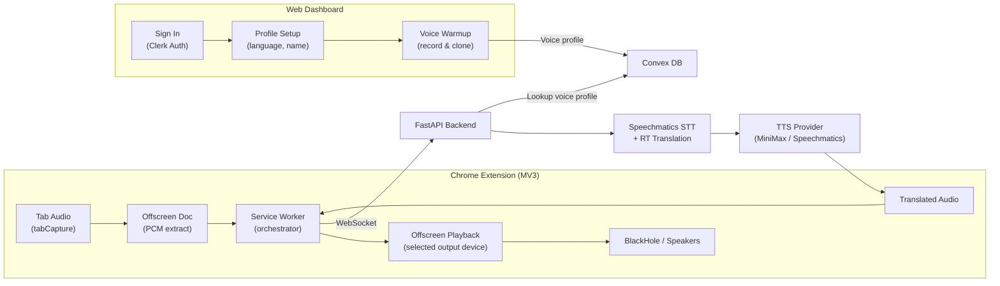

# Distill — Live Speaker Translation

A Chrome extension + FastAPI backend that translates live audio from web chat apps (Google Meet, Zoom, Discord, etc.) in real time. Hear everything in your native language, or route translated audio into the call.

## Architecture



**Audio routing flow:**

| Route                  | What happens                                                        |
| ---------------------- | ------------------------------------------------------------------- |
| **Speakers (default)** | You hear the translated audio locally                               |
| **BlackHole → Meet**   | Translated audio is routed into the call as your "microphone" input |

## Quick Start

If you just want to install and use Distill on your machine, do this:

### 1. Clone the repo

```bash
git clone <your-repo-url>
cd hackazona
```

### 2. Start the backend

```bash
cd backend
cp .env.example .env    # Add your API keys
uv sync
uv run uvicorn main:app --reload --port 8000
```

### 3. Build the Chrome extension

```bash
cd extension
npm install
npm run build
```

Then load in Chrome:

1. Go to `chrome://extensions`
2. Enable **Developer Mode**
3. Click **Load unpacked** → select `extension/dist` folder
4. Allow microphone permission when prompted (needed for device enumeration)

### 4. Use it

1. Open Google Meet, YouTube, or another supported tab
2. Click the **Distill** extension icon
3. Pick source and target language
4. Choose your output device
5. Click **Start Translation**

### 5. Optional: Web dashboard for voice profile setup

```bash
cd web
npm install
npx convex dev          # Start Convex dev server (needs CONVEX_DEPLOYMENT in .env.local)
npm run dev             # Starts on http://localhost:5174
```

The web dashboard requires a `.env.local` file with:

```env
VITE_CONVEX_URL=<your Convex deployment URL>
VITE_CLERK_PUBLISHABLE_KEY=<your Clerk publishable key>
VITE_SERVER_URL=http://localhost:8000
VITE_CONVEX_SITE_URL=<your Convex site URL>
CONVEX_DEPLOYMENT=<your Convex deployment>
```

Notes:

- Original tab audio passthrough is disabled in offscreen capture, so you should not hear untranslated + translated from the extension at the same time.
- If output is set to BlackHole 2ch, local speakers are silent by design unless you monitor with a Multi-Output device.

## Web Dashboard (Voice Profile & Cloning)

The web dashboard (`web/`) is a React app for managing user profiles and voice cloning. It lets users:

- **Sign in** via Clerk authentication
- **Set a display name and preferred language**
- **Record a voice sample** and create a MiniMax voice clone

When voice cloning is enabled, the backend looks up the speaker's voice profile from Convex during translation so listeners hear translated speech rendered in the original speaker's cloned voice.

**Stack:** React 18, Vite, Convex (database + file storage), Clerk (auth)

**How it connects:**

1. User signs in and creates a profile on the web dashboard.
2. User records a voice sample; the app uploads it to Convex storage and sends it to MiniMax to create a voice clone (`voiceProfileId`).
3. During a live call, the backend queries the Convex HTTP endpoint (`GET /api/voice-profile?userId=...`) to fetch the speaker's `voiceProfileId`.
4. If a valid profile exists, TTS renders in the cloned voice; otherwise it falls back to a standard voice.

## BlackHole Setup (Route Audio into Calls)

To let other meeting participants hear the translated audio:

### Install BlackHole

```bash
brew install blackhole-2ch
```

Or download from [existential.audio/blackhole](https://existential.audio/blackhole/).

### Configure

1. **Extension**: In the popup, select **BlackHole 2ch** as the Translation Output device
2. **Google Meet**: Go to Meet Settings → Audio → set **Microphone** to **BlackHole 2ch**

Now when you start translation, the translated audio plays into BlackHole, which Meet picks up as your microphone input. Other participants hear the translation.

> **Tip:** To hear the call yourself while routing audio into Meet, create a macOS Multi-Output Device in Audio MIDI Setup that combines your speakers + BlackHole.

## API Keys Required

| Service          | Credit                       | How to Get                                                 |
| ---------------- | ---------------------------- | ---------------------------------------------------------- |
| **Speechmatics** | $200 (code: `VOICEAGENT200`) | [portal.speechmatics.com](https://portal.speechmatics.com) |
| **MiniMax**      | $20                          | [minimax.io](https://www.minimax.io)                       |

## Latency Tuning

You can tune backend chunking and partial update behavior in `backend/.env`:

```bash
# Translation chunking
TRANSLATION_TRIGGER_CHAR_THRESHOLD=24

# Partial translated-text UI throttling
TRANSLATION_PARTIAL_MIN_DELTA_CHARS=12
TRANSLATION_PARTIAL_MIN_INTERVAL_MS=300

# Speechmatics finalization speed
SPEECHMATICS_MAX_DELAY=1.0
SPEECHMATICS_RT_WS_URL=wss://eu.rt.speechmatics.com/v2/

# Translation provider mode
USE_SPEECHMATICS_TRANSLATION=1
SPEECHMATICS_TRANSLATION_ENABLE_PARTIALS=1

# TTS provider mode
TTS_PROVIDER=speechmatics
# TTS_PROVIDER=minimax
# SPEECHMATICS_TTS_OUTPUT_FORMAT=wav_16000
# SPEECHMATICS_TTS_VOICE_ID=sarah
```

Guidance:

- Keep `USE_SPEECHMATICS_TRANSLATION=1` for the lowest end-to-end delay.
- `TTS_PROVIDER=speechmatics` is now the default.
- Switch to `TTS_PROVIDER=minimax` for broader multilingual voice coverage.
- Lower `TRANSLATION_TRIGGER_CHAR_THRESHOLD` for faster response.
- Higher `TRANSLATION_TRIGGER_CHAR_THRESHOLD` for fewer, larger chunks.
- Lower `SPEECHMATICS_MAX_DELAY` for faster final transcripts.
- Raise partial throttles if live text appears to constantly rewrite.

## Tech Stack

- **Extension**: React, TypeScript, Vite, CRXJS, Chrome MV3
- **Backend**: Python, FastAPI, WebSocket, uv
- **Web Dashboard**: React 18, TypeScript, Vite, Convex, Clerk
- **STT**: Speechmatics Real-time API
- **Translation**: Speechmatics RT Translation (recommended low-latency mode) or MiniMax M2 fallback
- **TTS**: MiniMax Speech 2.8 Turbo (default) or Speechmatics preview TTS (test option)
- **Voice Cloning**: MiniMax Voice Clone API (via web dashboard voice warmup flow)
- **Audio Routing**: BlackHole (macOS virtual audio loopback)
