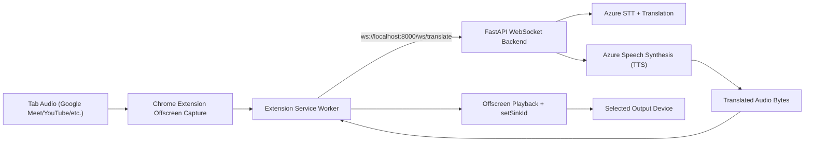
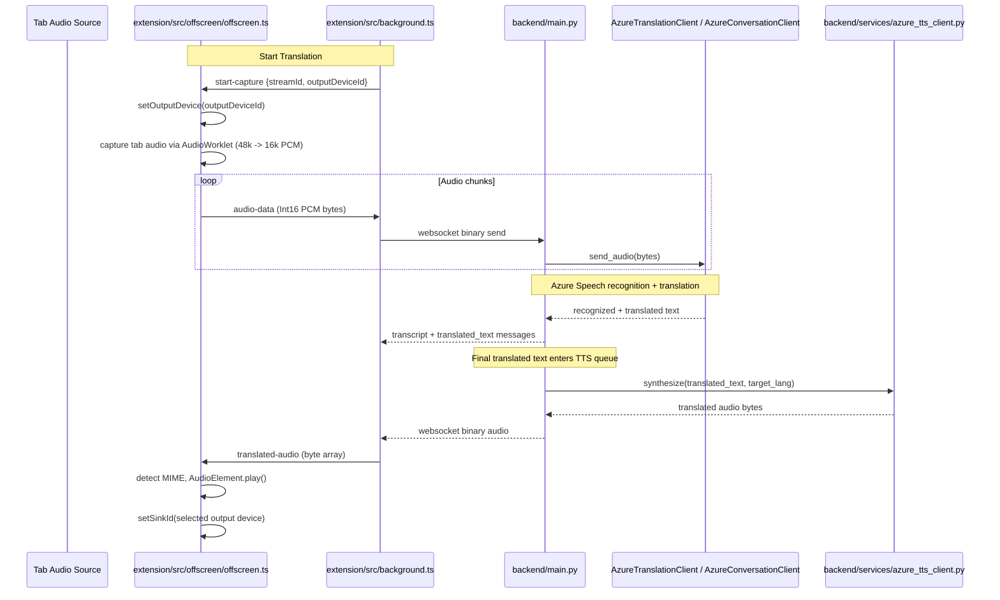

# Distill — Architecture

End-to-end data flow from tab audio capture to translated playback.

## High-Level Flow

## Detailed Sequence

## Runtime Controls (`backend/.env`)

- `STT_PROVIDER`
  - `azure` (default): uses `AzureTranslationClient` or `AzureConversationClient` depending on mode.
  - `speechmatics`: uses Speechmatics RT as alternative STT + translation path.

- `TTS_PROVIDER`
  - `azure` (default): uses Azure Speech Synthesis via `AzureTtsClient`.
  - `minimax`: uses MiniMax TTS as alternative.
  - `speechmatics`: preview test option.

- `AZURE_SPEECH_KEY`, `AZURE_SPEECH_REGION`
  - required for the live Azure STT and TTS path.

- `SPEECHMATICS_API_KEY`
  - required when using Speechmatics as STT or TTS provider.

- `MINIMAX_API_KEY`
  - required when using MiniMax as TTS provider.

- `TRANSLATION_TRIGGER_CHAR_THRESHOLD`, `AZURE_SEGMENTATION_SILENCE_MS`, `SPEECHMATICS_MAX_DELAY`
  - tuning parameters for translation timing and segmentation.

## Profiles and Storage

User profiles are managed by the backend and stored locally in SQLite. The storage layer lives in `backend/services/profile_store.py`. Relevant API routes:

- `GET /api/profiles`
- `POST /api/profiles`
- `GET /api/voice-profile`
- `POST /api/voice-profile`
- `PATCH /api/voice-status`

## Key Files

- Extension capture/playback:
  - `extension/src/offscreen/offscreen.ts`
  - `extension/src/background.ts`
- Backend orchestrator:
  - `backend/main.py`
- Azure provider clients:
  - `backend/services/azure_translation_client.py`
  - `backend/services/azure_conversation_client.py`
  - `backend/services/azure_tts_client.py`
- Alternative provider clients:
  - `backend/services/speechmatics_client.py`
  - `backend/services/speechmatics_tts_client.py`
  - `backend/services/minimax_client.py`
- Profile storage:
  - `backend/services/profile_store.py`
