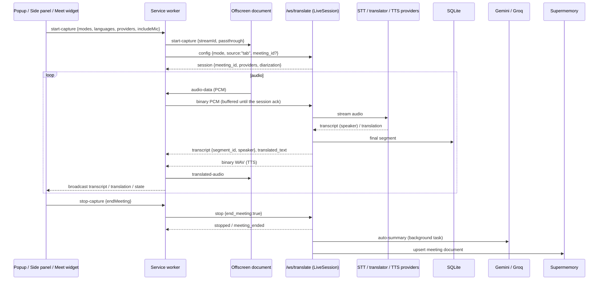

# Distill — Architecture

The standalone diagram is in [architecture.mmd](architecture.mmd).

## Components

| Piece | File(s) | Role |
|---|---|---|
| Popup | `extension/src/popup/` | Modes (translate / notes / my mic), languages, provider pickers, output device, Start/Stop, Memories search |
| Side panel | `extension/src/sidepanel/` | Live transcript, Summary, Ask (chat), Meetings history. Reads and writes through the REST API, plus live broadcasts |
| Service worker | `extension/src/background.ts` | Owns the backend WebSockets and session state (mirrored to `chrome.storage.session`). Broadcasts `target:"ui"` messages |
| Offscreen document | `extension/src/offscreen/offscreen.ts` | `tabCapture` and optional `getUserMedia` mic → 16 kHz Int16 PCM. Plays translated WAVs. Passthrough of the original audio |
| Meet widget, bridge and interceptor | `extension/src/content/meet-*.ts` | Floating controls on Meet. Outgoing voice translation by swapping Meet's mic track for the translated stream |
| Live session | `backend/services/session.py` | One per WebSocket: STT → optional translation → optional TTS. Stores final segments |
| Provider registry | `backend/services/providers/registry.py` | Capability matrix, key detection, defaults, validation |
| Meeting store | `backend/services/meeting_store.py` | SQLite tables `meetings`, `segments` and `chat_messages`, plus an FTS5 index |
| Summarizer | `backend/services/summarizer.py` | Schema-validated JSON summary, map-reduce for long meetings, one repair retry |
| Chat | `backend/services/chat.py` | SSE answers grounded in this meeting's transcript, or in Supermemory/FTS search across meetings |
| Memory sync | `backend/supermemory/sync.py` | Upserts one Supermemory document per meeting (checkpoints plus on end) |

## Audio and data flow

- **Your microphone in the notes.** The offscreen document opens the mic, after a one-time grant on `src/permissions/index.html`. It feeds a second WebSocket with `source:"mic"` and the same `meeting_id`, so your lines land in the same meeting as speaker `me`.
- **Outgoing translation (Meet only).** The interceptor patches `addTrack`, `addTransceiver` and `replaceTrack` and streams your mic PCM over a port to a third socket. That socket translates your speech into the meeting language. The translated WAVs play into a `MediaStreamDestination` whose track Meet sends to the other participants. When notes are on, this socket also transcribes you into the meeting, and the notes mic pauses.
- **Resilience:**
  - Audio is sent continuously, silence included. It is buffered (up to 15 s) until the backend acks the config.
  - A 20 s ping keeps the MV3 service worker alive.
  - Reconnects back off and resume the same `meeting_id`.
  - A restarted service worker restores its state from `chrome.storage.session`.

## WebSocket protocol (`/ws/translate`)

| Direction | Message |
|---|---|
| client → server | `{"type":"config", source_lang, target_lang, mode:{translate, transcribe}, source:"tab"\|"mic", meeting_id?, tab_url?, tab_title?, stt_provider?, tts_provider?, translator?}` |
| client → server | binary 16 kHz mono Int16 PCM; `{"type":"ping"}`; `{"type":"stop", end_meeting?}` (what the extension sends); `{"type":"end_meeting"}` (ends the meeting without closing STT) |
| server → client | `session` (meeting id, chosen providers, diarization), `transcript` (`text`, `is_final`, `speaker`, `source`, `segment_id`, `start_ms`), `translated_text_partial`, `translated_text`, binary WAV, `status` (`reconnecting` while the STT provider reconnects), `warning`, `error` (`code`: `provider_config`, …), `stopped`, `meeting_ended`, `pong` |

The types live in `extension/src/shared/protocol.ts`, kept in sync with `backend/services/session.py`.

## REST API

- `GET /api/providers`: which providers are configured, and the defaults.
- `GET/POST /api/settings`: dashboard key management. Values are masked when read back.
- `GET /api/meetings?q=`: list or search meetings.
- `GET /api/meetings/{id}?after_id=`: a meeting with its segments.
- `PATCH /api/meetings/{id}`: change `title`, `user_notes`, `speaker_names` or `summary_language`.
- `DELETE /api/meetings/{id}`
- `POST /api/meetings/{id}/end`
- `POST /api/meetings/{id}/summarize`, with an optional `language`.
- `GET /api/meetings/{id}/export.md?transcript=`
- `POST /api/meetings/{id}/sync-memory`
- `POST /api/chat`: takes `{question, scope:"meeting"|"all", meeting_id?, tab_url?, stream}` and returns SSE events `sources`, `delta`, `done` or `error`.
- `GET/DELETE /api/chat/history?meeting_id=`
- `POST /api/memories/query`: Supermemory search with an LLM-written answer (the popup's Memories tab).

## Configuration (`backend/.env`)

See `backend/.env.example` for every variable. The main groups:

- **Keys:**
  - `SONIOX_API_KEY`, `DEEPGRAM_API_KEY`, `SPEECHMATICS_API_KEY`
  - `AZURE_SPEECH_KEY` and `AZURE_SPEECH_REGION`, plus optional `AZURE_TRANSLATOR_KEY` and `AZURE_TRANSLATOR_REGION`
  - `MINIMAX_API_KEY`, `GEMINI_API_KEY`, `GROQ_API_KEY`, `SUPERMEMORY_API_KEY`
- **Defaults:** `STT_PROVIDER`, `TTS_PROVIDER`, `LLM_PROVIDER`, `TRANSLATION_PROVIDER`, `LLM_TRANSLATION_PROVIDER`.
- **Models:** `GEMINI_MODEL`, `GROQ_MODEL`, `SONIOX_STT_MODEL`, `DEEPGRAM_STT_MODEL` and others. Leave them blank to use the built-in defaults.
- **Notes:** `AUTO_SUMMARY`, `SUMMARY_LANGUAGE`, `MEMORY_CHECKPOINT_SECONDS`.
- **Latency tuning:** `TRANSLATION_TRIGGER_CHAR_THRESHOLD`, `TRANSLATION_FLUSH_MS`, `DEEPGRAM_ENDPOINTING_MS`, `SPEECHMATICS_MAX_DELAY`, `AZURE_SEGMENTATION_SILENCE_MS`.
